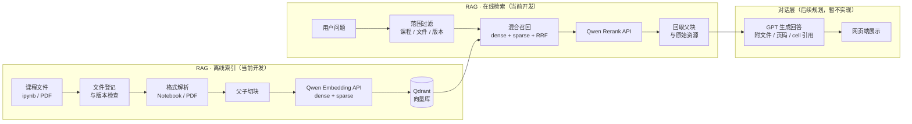

# 课程资料 RAG

面向课程资料（Notebook、PDF 课件等）的检索增强问答系统。当前阶段只开发 **RAG（检索）部分**：文件解析、切块、向量化、混合检索与重排；**对话部分**（基于检索证据生成回答）留待后续接入，网页端交互也在 RAG 基线稳定后再设计。

详细设计依据见 [`RAG.md`](./RAG.md)。

## 整体流程

- **RAG 部分**（离线索引 + 在线检索）：本 README 和 `RAG.md` 描述的重点，本地存储文件与向量库，模型推理调用 Qwen 官方 API。
- **对话部分**（图中灰色的 CHAT 层）：接收 RAG 检索到的证据，由 GPT 生成最终回答；当前不开发，仅在架构图中标出衔接点。

## RAG 部分：离线索引流程

对应 `RAG.md` 各阶段方法表第 1–7 步。

### 1. 文件登记
只导入选定课程文件，不对 `/Users/Link/Course` 全量扫描。对每个文件计算内容哈希，记录课程、文件路径、资料类型、版本、发布日期和导入状态；重复内容跳过，内容变更则生成新版本。发布日期由可信输入提供，不从目录名推断；未到发布日期的资料不进入可查询范围。

### 2. 格式解析
- **Notebook**：用 `nbformat` 按原始 cell 顺序读取 Markdown、代码、文本/HTML 输出、图片和附件，不执行 notebook；由 Markdown 标题建立章节路径，保留代码与其输出的关联。需处理异常/缺失的 cell ID，长输出、报错堆栈和大数组只保留可检索摘要。已确认部分课程存在中文重写版 notebook（中英夹杂、含 LaTeX 公式与 HTML 样式），双语支持按硬需求设计。
- **PDF**（第二批接入）：先提取原生文字与版面，再逐页检查文本质量；扫描页或图片型课件按需 OCR（可调用 `qwen-vl-ocr` / `qwen3-vl` 系列 API，不本地部署视觉模型）。保留页码、表格结构、公式与图表位置。抽查确认课程 PDF（Keynote/Beamer 导出）均有原生文字层、`pdftotext` 可直接提取，但文本密度低、图表承载主要信息，解析时需重视图注环节。
- 两种解析器统一产出 `document → section → block → asset` 结构；图片二进制不写入向量 payload。

### 3. 父子切块
父块是一个有边界的教学单元（小节、短课件页、相关 Markdown＋代码＋输出），约 1,000–1,800 tokens；子块是可独立匹配的定义、解释、代码逻辑或图表说明，约 300–600 tokens。标题、公式、函数和图表说明优先保持完整，不把整本 PDF 或整个 notebook 当父块，具体大小以检索题集效果调整。

### 4. 检索表示
每个正文子块附上简短的课程/文件/章节前缀；图表、复杂表格可有独立文字说明入口，均指回原始资源和父块。仅在评估显示收益时才为代码用途或章节摘要增加独立入口，暂不使用逐 token 的 ColBERT 多向量。

### 5. 向量化（Qwen API）与存储
调用 `text-embedding-v4`（Qwen3-Embedding 系列）**DashScope 原生接口**（非 OpenAI 兼容模式，只有原生接口才返回 sparse 向量），设置 `output_type=dense&sparse`，索引侧固定 `text_type=document`，一次调用同时获得：
- **dense 向量**：1,024 维（可选 64–2,048，MRL 灵活裁剪）
- **sparse 向量**：词项权重（index/value/token），用于关键词匹配

限制与用量：单次请求最多 10 条文本、单条最多 8,192 token；限流 RPM 1,800、TPM 120 万（仅输入）；价格约 ¥0.5/百万 token。按课程语料实测（约 200 万 token）估算，全量索引约需 500–700 次请求、几分钟内可完成，成本约 ¥1 元量级，不构成瓶颈。

向量与可过滤元数据（课程、文件、版本、发布日期、章节路径、cell/页码等）写入本机 Qdrant；父块正文与文件清单存 SQLite；原始文件与图片资源留在文件存储中。记录模型版本、维度和索引版本，便于后续更换配置时重建索引。

## RAG 部分：在线检索流程

对应 `RAG.md` 各阶段方法表第 8–9 步。

### 6. 查询与召回
先解析用户明确选择的课程/文件范围和当前可见版本；原问题并行走 dense、sparse 检索，查询侧调用 embedding API 时使用 `text_type=query`（与索引侧的 `document` 区分，提升非对称检索效果），用 RRF 融合候选。保留课程编号、代码符号、公式和否定词，避免被过度改写。指代不明时补全问题；中文问英文课件时保留原问并增加英文术语查询。HyDE、step-back、多查询默认关闭，仅在评测显示收益时启用。

### 7. 重排与回取
对融合后的有限候选调用 `qwen3-rerank` API（单次最多 500 篇候选、单篇最多 4,000 token、请求总 token 上限 12 万，限流 RPM 5,400，几乎不构成瓶颈；`gte-rerank` 将于 2026-05-30 停服，不使用）。按 `parent_id` 去重后回取必要的父块、相邻 cell、原图或原表，并限制总上下文长度，记录每条证据的具体来源（文件、页码或 cell）。

## 对话部分（后续规划，当前不实现）

后续问答层优先接 GPT（以账户和服务地区实际可用性为前提），只依据检索证据回答，给出文件名、页码或 cell 引用；资料不足时明确说明缺口。课程/考试总结类问题走"按文件和章节枚举证据 → 分节汇总"的流程，不依赖一次 top-k 查询。这部分不在当前开发范围内，架构图中仅标出与 RAG 部分的衔接点（检索证据 → GPT → 网页展示）。

## 增量更新与评估

- **增量更新**：新文件生成父块、子块和资源后再切换为可见版本；替换或删除文件时同步清理旧子块、派生说明和失效资源；每次导入记录失败与重试状态。检索时同时校验 `document_id`、版本和发布日期，避免旧版或未解封内容泄露。
- **评估**：人工标注约 60–100 个课程问题及原文件页码/cell，覆盖概念、代码、图表、指定文件、跨章节和无答案题；测 `Recall@k`、`nDCG@k`、引用准确性、回答依据、延迟与资源占用。固定同一题集，对比单层块、父子块、混合检索、多表示与重排的效果差异；课程总结另测章节覆盖率，增量导入另测旧版本清理是否彻底。

## 技术选型摘要

| 组件 | 选型 | 说明 |
| --- | --- | --- |
| 向量库 | Qdrant（本机 Docker） | dense + sparse 命名向量，支持课程/版本/发布日期等元数据过滤 |
| 元数据与父块存储 | SQLite | 文件清单、版本、父块正文、资源关系 |
| Embedding | `text-embedding-v4`（Qwen API，DashScope 原生接口） | 一次调用同时获取 dense + sparse，不本地部署 |
| Reranker | `qwen3-rerank`（Qwen API） | 对融合候选做语义重排 |
| 对话模型（后续） | GPT | 仅在检索证据基础上生成回答，当前不开发 |

## 关键约束

- **Notebook 是首要数据模型**：cell 输出可能包含图片、HTML 表格或多种 MIME 表示，不能整份转纯文本后固定字符数切割。
- **图表说明是检索线索，不是精确事实来源**：回答图中数值或曲线关系时需回取原图、表格或原始输出核对。
- **父子块与多表示可以组合**：父子块解决"找到细节后补足上下文"，多表示解决"正文之外怎样找到代码、图和表"；不为每个子块复制同一份标题或章节摘要向量。
- **存储与推理分离**：Qdrant、SQLite、原始文件保存在本地（后续可迁移到云端）；embedding、重排及未来可能的图像描述均调用 Qwen API，云端小机器只需承担存储和编排。
- **全部依赖外部 API**：需处理限流重试（embedding 单次请求上限 10 条文本）、网络异常降级、API Key 保密，以及课件内容出境到第三方服务的取舍。
- **先测后调**：token 范围、候选数量、模型配置均是初始值，最终以真实课程问题的效果、延迟证据决定。

## 首个可验收里程碑

选取少量具有 Markdown 说明、代码、图片输出的 notebook，完成导入、父子块检索、按文件过滤及 cell 引用；建立一批人工问题，对比纯 dense、dense+sparse、加重排、加父块回取。该基线稳定后，再接入 PDF 和对话层。

## 参考资料

- [Jupyter Notebook 文件格式](https://nbformat.readthedocs.io/en/latest/format_description.html)
- [通用文本向量 API（text-embedding-v3/v4，dense+sparse 混合检索）](https://help.aliyun.com/zh/model-studio/text-embedding-synchronous-api)
- [通用文本排序模型 API（qwen3-rerank）](https://help.aliyun.com/zh/model-studio/text-rerank-api)
- [阿里云百炼限流说明](https://help.aliyun.com/zh/model-studio/rate-limit)
- [Qwen3 Embedding 与 Reranker 技术背景](https://github.com/QwenLM/Qwen3-Embedding)（仅供架构原理参考，本项目通过 API 调用而非本地部署）
- [Qdrant 本地部署](https://qdrant.tech/documentation/quick-start/)与[混合查询](https://qdrant.tech/documentation/search/hybrid-queries/)
- [Docling 切块](https://docling-project.github.io/docling/concepts/chunking/)与[图片 OCR 序列化说明](https://docling-project.github.io/docling/_generated/examples/advanced_chunking_and_serialization/)
